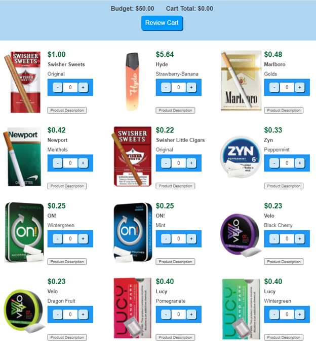
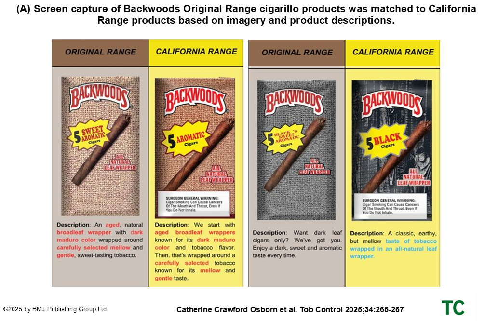

## Youth Risk Behavior Survey Interactive

::: column-page
```{=html}
<iframe src="https://public.tableau.com/views/YRBS2021Infographic/Dashboard1?:embed=y&:showVizHome=no&:toolbar=yes"
        width="100%" height="850" style="border:none;"></iframe>
```
:::

### About:

I began working on the Youth Risk Behavior Survey in 2018 as a research coordinator at the [Prevention Research Center for Healthy Neighborhoods](https://prchn.org/ccyrbs/), overseeing administrations for Summit and Cuyahoga Counties, as well as the CDC-DASH Cleveland Sample. In 2019, I led the process of our site gaining the first round of CDC/Westat approval for web-based administration of the survey using Qualtrics and regularly met with fellow grantees providing technological assistance on online administration designs during the 2021 COVID-era cycle. As part of the PRCHN YRBS team, I developed infographics and data briefs to disseminate survey findings. I streamlined processes to automate school- and county-level report building to improve data integrity and efficiency. I also led the web-based administration of the Ohio Department of Health's 2021 and 2023 Youth Risk Behavior Survey/Youth Tobacco Survey. I remained a part of that team through 2024.

### Article:

Trapl E, Pike Moore S, **Osborn C**, Gupta N, Love TE, Kinzy TG, Kinsella A, Frank S. Evaluation of Restrictions on Tobacco Sales to Youth Younger Than 21 Years in Cleveland, Ohio, Area. *JAMA Netw Open.* 2022;5(7):e2222987. doi:[10.1001/jamanetworkopen.2022.22987](https://jamanetwork.com/journals/jamanetworkopen/fullarticle/2794152)

------------------------------------------------------------------------

## Online Experimental Tobacco Marketplace



### About:

As part of the [Cigarillo Flavor and Abuse Liability, Attention, and Substitution in Youth](https://prchn.org/cflash/) (C-FLASH) project (2019-2023), I built the online survey and experimental tobacco marketplace in Qualtrics which allowed participants to hypothetically purchase tobacco products based on their flavor preferences and budget, while varying the prices of individual items. Due to the online nature of study recruitment, this project required complex screening procedures to reduce fraud and maintain data quality.

### Articles:

**Osborn CC**, Suratkal JP, Pike Moore SN, Koopman Gonzalez S, Sterling KL, Quisenberry AJ, Klein EG, Trapl ES. Dissonance in Young Adult Cigarillo Users’ Categorization of Concept Flavored and Unflavored Products. *International Journal of Environmental Research and Public Health*. 2022; 19(12):7219. doi:[10.3390/ijerph19127219](https://www.mdpi.com/1660-4601/19/12/7219)

Abeyesundere N, **Osborn CC**, Pike More S, Suratkal JP, Kaur M, Otieno C, Quisenberry AJ, Klein EG, Trapl ES. Substitution of flavored cigarillos with menthol cigarettes among young adults in the US. *Drug and Alcohol Dependence*. 2022 Oct 1; 239:109603. doi:[10.1016/j.drugalcdep.2022.109603](https://www.sciencedirect.com/science/article/pii/S0376871622003404?via%3Dihub)

Pike Moore S, **Osborn C**, Koopman Gonzalez S, Quisenberry A, Klein EG, Kaur M, Suratkal J, Trapl E. Flavour loyalty may predict cessation or substitution following a cigarillo flavour ban among young adults in the USA. *Tobacco Control* 2022;31:s206-s213. doi:[10.1136/tc-2022-057487](https://tobaccocontrol.bmj.com/content/31/Suppl_3/s206)

**Osborn C**, Pike Moore S, Koopman Gonzalez S, Quisenberry A, Klein E, Trapl E, Come for the Tobacco, Stay for the Flavor: Flavored Cigarillo–Use Trajectories Among Young Adult Sexual Gender Minority Women, *Nicotine & Tobacco Research*. 2024; 26(2): S112–S120, doi:[10.1093/ntr/ntad168](https://doi.org/10.1093/ntr/ntad168)

Pike Moore S, **Osborn C**, Suratkal J, Vasu P, Koopman Gonzalez S, Trapl E. What is (Un)Flavored? A scoping review of the conceptualization of flavored cigarillos. *Nicotine & Tobacco Research*. 2024; 26(9): 1120-1131. doi:[10.1093/ntr/ntae039](https://academic.oup.com/ntr/article/26/9/1120/7613836)

Quisenberry AJ, **Osborn CC**, Pike Moore S, Schneller L, John L, Klein EG, Trapl E. Electronic Nicotine Delivery Devices Function as a Complement for Cigarillos in Sexual and Gender Minority Young Adult Women. *Nicotine & Tobacco Research*. 2025; 27(3): 494-501. doi:[10.1093/ntr/ntae197](https://academic.oup.com/ntr/article/27/3/494/7736066)

------------------------------------------------------------------------

## Emerging Tobacco Product Surveillance



### About:

Starting in 2022, I developed a series of web scrapers that regularly collected information from top cigarillo brand websites on listed products' images, descriptions, and categories. Web scrapers sent notifications about changes to website structure and regularly compared past week images and descriptions to current ones to detect changes to product listings in anticipation of 2024 federal flavor restrictions. As shown in the article figure above, these scrapers detected the debut of rebranded Backwoods cigars as part of their "California Range" to conform to California's state-wide flavored tobacco policy.

### Article:

**Osborn CC**, Pike Moore S, Machta A, Trapl E. Backwoods cigars release 'California Range' of products with concept flavour names. Tob Control. 2025 Apr 1;34(2):265-267. doi: [10.1136/tc-2023-058292](https://pubmed.ncbi.nlm.nih.gov/37914388/).

### Presentation:

**Osborn C**. Technology for automating surveillance of web-based flavored tobacco marketing. Society for Research on Nicotine & Tobacco Annual Meeting. Edinburgh, Scotland. Mar 20-23, 2024.
